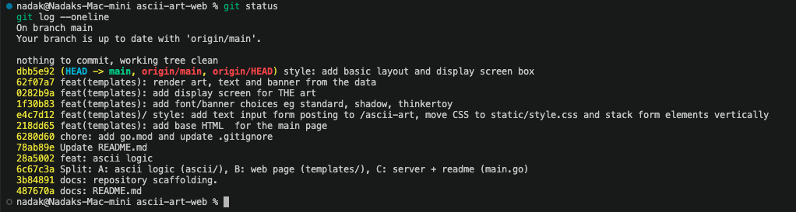

# ascii-art-web

A small web page that turns your text into ASCII art, for anyone who wants to try ascii-art without the terminal.

## Description
ascii-art-web is a Go HTTP server that gives a web GUI to our previous project, ascii-art.
You type a text, pick a banner (`standard`, `shadow` or `thinkertoy`), press the button, and the server sends back the page with your text drawn in ASCII art.



## Authors
- Zineb Nadak ([zinebnadak](https://github.com/zinebnadak))
- Mohamed Bouras (mbouras)

## Usage: how to run
You need Go installed.

```bash
git clone https://github.com/zinebnadak/ascii-art-web.git
cd ascii-art-web
go run .
```

Then open [http://localhost:8080](http://localhost:8080) in your browser.

| Method | Route        | What it does                                  |
|--------|--------------|-----------------------------------------------|
| GET    | `/`          | Shows the main page                           |
| POST   | `/ascii-art` | Receives `text` and `banner`, shows the art   |

Status codes:
- `200 OK` when everything works
- `400 Bad Request` for empty text, an unknown banner, or characters that are not printable ASCII
- `404 Not Found` for unknown pages, or when a template or banner file is missing
- `405 Method Not Allowed` when the wrong method is used on a route
- `500 Internal Server Error` for anything else that goes wrong

## Implementation details: algorithm
1. Each banner file has the 95 printable ASCII characters (from space ` ` to `~`), in order.
   Every character is 8 lines tall and there is one empty line before each one, so a character takes 9 lines.
2. The server reads the chosen banner file and splits it into lines (`\r\n` is turned into `\n` first, because `thinkertoy.txt` uses Windows line endings).
3. The start line of a character is found with: `(character - 32) * 9 + 1`.
4. The text from the form is split on new lines. For every part:
   - if it is empty, we add one empty line;
   - otherwise we build 8 rows, and for each row we join the matching line of every character.
5. The result is put in the `templates/index.html` template inside a `<pre>` tag, so spaces and line breaks stay the same.

Project structure:
```
main.go           server, routes and status codes
art.go            turns the text into ASCII art
templates/        HTML template
static/           CSS
banners/          standard, shadow and thinkertoy
```

Built at [grit:lab](https://gritlab.ax/) Åland (01-edu peer-learning program).
